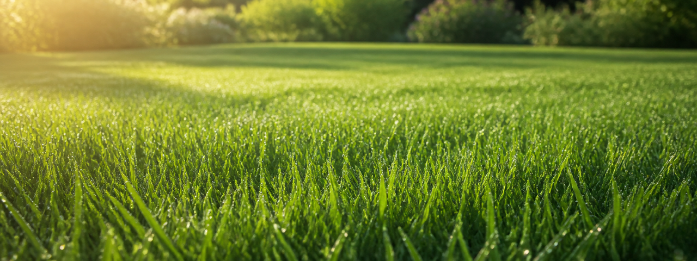

# Lawn Control



<p align="center">
  <a href="https://github.com/Ralleberg/lawn_control/releases">
    
  </a>
  <a href="https://github.com/Ralleberg/lawn_control/blob/main/LICENSE">
    
  </a>
  <a href="https://github.com/Ralleberg/lawn_control/releases">
    
  </a>
</p>

<p align="center">
  <a href="https://my.home-assistant.io/redirect/hacs_repository/?owner=Ralleberg&repository=lawn_control&category=integration">
    
  </a>
</p>

---

## Overview

**Lawn Control** is a Home Assistant custom integration that provides intelligent lawn care recommendations based on weather forecasts, historical weather data, and optional environmental sensors.

Instead of controlling hardware directly, Lawn Control continuously analyzes lawn conditions and exposes entities that can be used in Home Assistant dashboards, automations, and notifications.

### Features

- 🌱 Recommended grass height
- 🌧️ Drought risk assessment
- 📈 Estimated grass growth
- 🧪 Fertilizer effectiveness tracking
- 🤖 Robot mower permission
- ✂️ Configurable mowing recommendation frequency
- 🍂 Scarifying recommendation
- 💧 Historical, forecast and combined rainfall analysis
- ⚙️ Fully configurable rule engine
- 🌍 English and Danish translations

> [!NOTE]
> Lawn Control is an **advisory integration**.
> It never controls robot mowers or irrigation systems directly.
> Instead it exposes entities that you can use in your own Home Assistant automations.

---

# Installation

## HACS (Recommended)

Click below to add the repository directly to HACS.

<p align="center">
  <a href="https://my.home-assistant.io/redirect/hacs_repository/?owner=Ralleberg&repository=lawn_control&category=integration">
    
  </a>
</p>

After adding the repository:

1. Open **HACS**
2. Install **Lawn Control**
3. Restart Home Assistant
4. Navigate to **Settings → Devices & Services**
5. Add the **Lawn Control** integration

---

# Configuration

The setup wizard guides you through configuring the integration.

## Required

- Weather entity

## Optional sensors

- Rain sensor
- Temperature sensor
- Humidity sensor
- Soil moisture sensor

## Lawn settings

- Lawn type
- Soil type
- Shade level
- Care level
- Minimum grass height
- Maximum grass height

## Watering

- Whether the lawn is watered during dry periods
- Watering level

## Robot mower

- Whether a robotic mower is present
- Whether mowing is allowed between sunset and sunrise

## Mowing recommendation frequency

- Every hour
- Every 4 hours
- Every 6 hours
- Once per day, using the configured daily assessment hour

When mowing at night is disabled, the daily assessment hour is also the earliest
time of day where mowing can be recommended as `true`.

## Fertilizer

Optional fertilizer configuration:

The fertilizer NPK percentages are managed through dedicated Home Assistant
number entities after setup:

- `number.lawn_fertilizer_n_percent`
- `number.lawn_fertilizer_p_percent`
- `number.lawn_fertilizer_k_percent`

The latest fertilizer date is managed through the `date.lawn_last_fertilized_date`
entity after setup. Update these entities directly from Home Assistant whenever
fertilizer is applied or the fertilizer composition changes.

---

# Entities

| Entity | Description |
|----------|-------------|
| `sensor.lawn_recommended_grass_height` | Recommended grass height with detailed decision attributes. |
| `sensor.lawn_drought_risk` | Current drought risk and score details. |
| `sensor.lawn_growth_rate` | Estimated grass growth including fertilizer and weather effects. |
| `sensor.lawn_fertilizer_score` | Remaining fertilizer effectiveness from 0–100. |
| `sensor.lawn_historical_rain` | Historical rainfall used by the rule engine. |
| `sensor.lawn_forecast_rain` | Forecast rainfall used by the rule engine. |
| `sensor.lawn_combined_rain` | Combined rainfall used for moisture calculations. |
| `sensor.lawn_care_recommendation` | Human-readable lawn care summary. |
| `date.lawn_last_fertilized_date` | Latest fertilizer application date used by fertilizer and growth calculations. |
| `number.lawn_fertilizer_n_percent` | Nitrogen percentage used by fertilizer and growth calculations. |
| `number.lawn_fertilizer_p_percent` | Phosphorus percentage used by fertilizer and growth calculations. |
| `number.lawn_fertilizer_k_percent` | Potassium percentage used by fertilizer and growth calculations. |
| `binary_sensor.lawn_good_day_for_fertilizer` | Indicates whether fertilizing is recommended. |
| `binary_sensor.lawn_should_mow` | Mowing recommendation for the configured update frequency. Not created when robotic mower support is enabled. |
| `binary_sensor.lawn_robot_mower_should_run` | Indicates whether a robot mower should be allowed to operate. |
| `binary_sensor.lawn_should_verticut` | Indicates whether scarifying is recommended. |

---

# How Lawn Control Works

The rule engine combines weather data, optional sensors and configurable lawn settings to generate recommendations.

The calculations consider:

- Historical rainfall
- Forecast rainfall
- Temperature
- Humidity
- Soil moisture
- Soil type
- Lawn type
- Shade level
- Watering habits
- Season
- Fertilizer age
- Fertilizer composition
- Current growth conditions

Every advisory entity exposes detailed attributes so the reasoning behind every recommendation can be inspected.

Recommended grass height and the other advisory sensors update hourly, while mowing recommendations stay in effect for the configured frequency. Source entity changes can trigger immediate refreshes.

If the required weather entity is unavailable, all Lawn Control entities become unavailable. Configured optional sensors can be unavailable without stopping the rule engine; affected source entities are listed in each entity's attributes.

---

# Recommendation Logic

## Grass Height

Monthly protective minima take precedence over both preferred height settings.
A higher configured minimum is respected, including for ornamental lawns.

| Month | Robot mower minimum | Conventional mower minimum |
|-------|---------------------|----------------------------|
| March | 50 mm | 60 mm |
| April | 40 mm | 60 mm |
| May–September | 40 mm | 50 mm |
| October | 50 mm | 60 mm |
| November–February | 50 mm retained autumn protection | 60 mm retained autumn protection |

Winter values retain the autumn minimum; mowing is blocked from November through
February. Shade, summer stress and wear can increase the protective minimum.
If the preferred maximum is too low, the protective minimum overrides it.
`seasonal_min_height`, `configured_min_height`, `configured_max_height`,
`configured_max_overridden`, `min_height`, `max_height` and `reason` expose the
resulting decision. Heights are in millimetres.

Recommended grass height is also adjusted according to available moisture and seasonal growth.
The height model distinguishes rain from the last 24 hours, probability-weighted
rain expected during the next 24 hours and longer-range rain. Forecast sun, heat,
humidity and rain are combined into a 72-hour drying pressure so rain late in the
forecast does not lower the mowing height before an intervening dry spell.
Strong forecast drying pressure takes precedence over near-term rain when there
is no adequate soil moisture or configured watering support.

Remove at most one third of the grass height in one cut. For a tracked robot
mower, the integration raises the target when its estimated current height would
otherwise require a larger cut, even above the preferred maximum. This estimate
uses the last registered run and modelled growth; it is not a measured height or
confirmation of the mower's actual cutting setting. Check actual height and lower
long grass gradually over several cuts. Without tracking, the one-third rule is
provided as advice in the mowing entity's `cutting_guidance` attribute.

## Drought Risk

Rainfall deficits and sunlight are weighted by atmospheric drying demand derived
from paired outdoor temperature and relative humidity readings (current and
recent mean). Cool, humid air reduces the deficit weight; warm, dry air increases
it. The paired samples use the FAO-56 saturation vapour pressure formula, retaining
the higher recent vapour pressure deficit so a humid night does not hide a dry day.
This is a heuristic risk score, not a full evapotranspiration or soil water model.
The physical basis is described in [FAO's meteorological guidance](https://www.fao.org/4/X0490E/x0490e07.htm).

Humid air does not prove that soil is wet: measured soil moisture below 25 retains
at least medium risk, and below 15 at least high risk, even if watering is enabled.
The sensor exposes `temperature`, `humidity`, `vapour_pressure_deficit_kpa`,
`rain_deficit_weight`, `soil_moisture` and an explanation of the adjustment.

Calculated using:

- Rain history
- Rain forecast
- Temperature
- Humidity
- Soil moisture
- Soil type
- Watering
- Season

## Growth Rate

Outdoor temperature already affects growth and therefore tracked grass height:
stored hourly growth rates are integrated since the last registered mower run.
At or below 6 °C the model estimates zero growth; from 6 to 12 °C growth and
fertilizer bonuses increase gradually. The cooler of the current air temperature
and available 24-hour mean is used, preventing a brief warm afternoon from
restarting growth while the recent weather remains cold. These are advisory air
temperature thresholds, not measured soil temperatures or universal biological
limits. Estimated current grass height and recommended cutting height remain
separate concepts; monthly minimum cutting heights still apply.

### Season status on existing entities

The growth sensor now exposes `mowing_season_status`, `mowing_season_label`,
`mowing_season_reason` and `winter_storage_recommended`. The care recommendation
also shows the seasonal message, so an existing card using that entity can show
storage advice and season readiness without an additional entity.

| Status | Meaning |
|--------|---------|
| `winter_pause` | November–February, or sustained cold autumn weather: winter storage advised. |
| `cold_pause` | Current or recent mean temperature is at most 6 °C, or snow: pause mowing; a cold night alone does not imply winter storage. |
| `warming_up` | After a pause, wait until current and available daily mean temperatures reach 8 °C. |
| `ready` | March–October and temperature readiness satisfied; daily weather, moisture and growth checks still apply. |
| `unknown` | No usable current or recent temperature data. |

Readiness persists down to just above 6 °C once established; after a pause, 8 °C
is required to restart. This status is stored across integration restarts.
Autumn storage advice in September–October requires a three-day mean at or below
6 °C, at least 48 distinct hourly samples spanning 70 hours, and current cold
conditions. The mean and coverage are exposed as `seasonal_temperature_72h` and
`seasonal_temperature_coverage_hours`. Sparse history cannot trigger early storage.
The seasonal message reports temperature readiness, not permission to run today:
night restrictions, rain, drought and insufficient growth can still prevent mowing.

For a Markdown dashboard card, the existing growth sensor's message can be shown
with `{{ state_attr('sensor.lawn_growth_rate', 'mowing_season_label') }}`. Replace
the entity ID with the one in your installation if it differs.

Growth depends on:

- Season
- Temperature
- Moisture
- Drought stress
- Fertilizer effect

## Fertilizer

The fertilizer score estimates remaining fertilizer age effect using:

- Fertilizer age
- Whether the configured fertilizer contains nitrogen

Fertilizer-driven growth bonus also considers:

- NPK composition
- Nitrogen strength
- Moisture availability

## Mowing

Mowing recommendations consider:

- Wet grass
- Forecast rainfall
- Drought stress
- Current growth
- Recent weather

Mowing is blocked outside March–October, in frost or snow, on measured dry soil,
and ahead of a strong forecast dry spell without moisture support. A watering
preference cannot override measured dry soil. Robot catch-up obeys these same
protections. Cold or dormant grass stays at zero estimated growth even when
fertilizer or favorable weather would otherwise add a growth bonus.

Use sharp blades, avoid wet grass and morning dew, distribute or collect clumps
of clippings, and vary mowing routes to reduce wheel tracks. Prefer robot starts
after 09:00 when dew is a concern; the existing start-hour and night preferences
remain configurable. In autumn, keep a high final cutting setting and remove
thick layers of leaves. During drought, pause mowing; watering is optional and,
if used, should be infrequent and deep (about 20 mm per application).

The mowing recommendation is locked for the configured frequency: every hour, every 4 hours, every 6 hours, or once per day at the configured daily assessment hour. Live blocking factors immediately suspend a locked recommendation, and its recommended height always follows the current protected height. When mowing at night is disabled, mowing is forced off between sunset and sunrise and before the configured daily assessment hour.

## Robot Mower

The robot mower permission sensor evaluates:

- Current mowing suitability
- Wet conditions
- Forecast rainfall
- Drought stress
- Optional night mowing restrictions

## Scarifying

Scarifying is not routine maintenance or a default moss treatment. A positive
recommendation requires the `high` care level, normal or fast growth, adequate
moisture and suitable weather between May 1 and September 15. The `aftercare`
attribute explains the need for overseeding, topdressing and moisture during
establishment. The integration cannot verify lawn health or completion of this
aftercare; inspect the lawn before proceeding.

Scarifying recommendations are based on:

- Season
- Moisture
- Growth
- Drought stress
- Current lawn conditions

---

# Automation Examples

Lawn Control is intended to work together with Home Assistant automations.

Typical examples include:

- Pause a robot mower when mowing is not recommended.
- Notify when fertilizing conditions are ideal.
- Trigger irrigation when drought risk becomes critical.
- Display lawn recommendations on dashboards.
- Schedule mowing only on suitable days.

---

# Languages

The integration currently includes:

- 🇬🇧 English
- 🇩🇰 Danish

Additional translations are welcome through pull requests.

---

# Development

Verify the integration syntax:

```bash
python3 -m compileall custom_components
python3 -m unittest discover -s tests -v
```

---

# Contributing

Contributions are always welcome.

If you discover a bug, have ideas for improvements, or would like to enhance the rule engine, please open an issue or submit a pull request.
